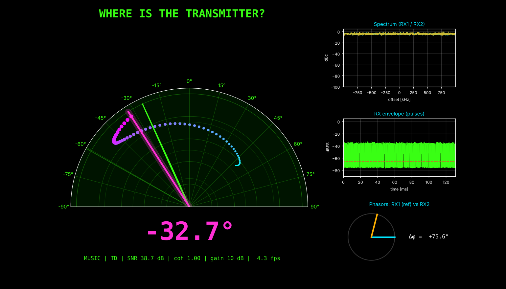

# Find the Transmitter 📡🧭

**Live angle-of-arrival (AoA) direction finding with a PlutoSDR+ and two monopole antennas.**

Someone walks around the room with a transmitter. A radar-style needle on the screen follows them in real time, using nothing but the phase difference between two antennas 6 cm apart.

<p align="center">
  
</p>
<p align="center"><sub>Screenshot from the built-in simulator (<code>--sim</code>): transmitter walking across ±50°.</sub></p>

Made by the IEEE Student Branch, University of Patras: Electronics SIG (RF/analog track).

---

## How it works

A wave arriving from angle θ reaches one antenna slightly before the other. With antenna spacing *d* and wavelength λ, the extra path is *d·sin θ*, which shows up as a phase difference between the two receive channels:

$$\Delta\varphi = \frac{2\pi d}{\lambda}\sin\theta \quad\Rightarrow\quad \theta = \arcsin\!\left(\frac{\lambda\,\Delta\varphi}{2\pi d}\right)$$

The Pluto+ has two receive channels driven by the **same local oscillator**, so their relative phase is meaningful. Each buffer, the script:

1. **Detects the signal**, running two detectors and keeping the better one:
   - **NB** (narrowband): band-pass around the strongest spectral line, best for a CW tone or long pulses.
   - **TD** (time-domain): gate on samples whose power is well above the noise, best for short pulses and Wi-Fi beacons.
2. **Measures Δφ** from the detected samples only (`angle(Σ x₂·x₁*)`), minus the calibration offset.
3. **Rejects bad frames**: if the RX1/RX2 *coherence* is below 0.85 (noise, multipath, two transmitters at once), the frame is ignored and the needle holds.
4. **Filters**: a 5-point median (kills outliers) and light exponential smoothing.
5. **Draws** the angular spectrum. `m` switches between **Bartlett** (delay-and-sum: a broad blob, because two antennas make a fat beam) and **MUSIC** (subspace method: a sharp spike in the same direction). Same antennas, very different "resolution": the algorithm matters.

### Things the demo teaches

| Try this | You see | Lesson |
|---|---|---|
| Run without pressing `c` | angle is wrong | the two RX chains have a random phase offset, so arrays need **calibration** |
| Pull antennas to ~12 cm (≈ λ) | needle jumps between angles | **grating lobes / spatial aliasing**, the spatial version of sampling too slowly |
| Stand next to a metal cabinet | errors, coherence drops | **multipath** |
| Walk past ±60° | accuracy degrades | sensitivity ∝ cos θ, worst at **endfire** |
| Lower the TX power in 5 dB steps | needle gets noisier | angle accuracy depends on **SNR** (Cramér–Rao bound) |
| Press `m` | blob ↔ spike | **Bartlett vs MUSIC** |

---

## Hardware

| Item | Notes |
|---|---|
| PlutoSDR+ (AD9361, 2R2T) | must be in **2r2t** mode (below) |
| 2 identical monopoles on RX1 and RX2 | vertical, same height, **6.25 cm apart** (≈ λ/2 at 2.4 GHz), equal-length cables, tape cables down |
| A transmitter | a phone Wi-Fi hotspot (default), or a spectrum analyzer / signal generator with a monopole |
| Laptop | Windows, Linux or macOS, Python 3.10+ |

Room layout: array at a table edge, at least 1 m from metal. Tape an arc on the floor 2–3 m away with marks every 15° (sideways offset *x = r·sin θ*) so the audience can compare the needle with reality.

### Put the Pluto+ in 2r2t mode (once)

```bash
ssh root@192.168.2.1          # password: analog
fw_setenv attr_name compatible
fw_setenv attr_val ad9361
fw_setenv mode 2r2t
reboot
```

Check: `iio_info -u ip:192.168.2.1` should list `adi,2rx-2tx-mode-enable value: 1` and four RX channels.

---

## Install

1. Install the **libiio** C library: Windows installer from [analogdevicesinc/libiio releases](https://github.com/analogdevicesinc/libiio/releases), `sudo apt install libiio-utils libiio-dev` on Debian/Ubuntu, `brew install libiio` on macOS.
2. Python environment:

```powershell
python -m venv .venv
.\.venv\Scripts\Activate.ps1          # Linux/macOS: source .venv/bin/activate
python -m pip install -r requirements.txt
python -c "import adi; print(adi.ad9361('ip:192.168.2.1').rx_lo)"
```

> **`pylibiio` must match your libiio version.** `iio_info -V` tells you which one you have. The Pluto drivers usually ship 0.25, hence `pylibiio==0.25`. With pylibiio 1.0 against libiio 0.x you get `Could not find libiio C library`.

## Run

```bash
python pluto_aoa_radar.py --sim   # no hardware: simulated transmitter walking around
python pluto_aoa_radar.py         # real Pluto+
```

**Order:** transmitter ON → **`g`** (auto gain) → transmitter at **0°** → **`c`** (calibrate) → walk.

| Key | Action |
|---|---|
| `g` | auto-range RX gain, then lock it (gain changes can shift the RX1/RX2 phase, so it never changes by itself) |
| `c` | calibrate: store the RX1/RX2 phase offset with the transmitter at 0° |
| `f` | flip direction (if the needle moves the wrong way) |
| `m` | Bartlett ↔ MUSIC |
| `r` | clear the track |
| `q` | quit |

The console prints a `[diag]` line every second (SNR per detector, coherence, detected samples, peak level, gain, fps). Read it first when something misbehaves.

---

## Transmitter modes

Set at the top of `pluto_aoa_radar.py`:

### `PHONE_MODE = True` (default): phone Wi-Fi hotspot

- Turn on a **2.4 GHz** hotspot with **nothing connected** (iPhone: enable *Maximise Compatibility*; Android: AP band 2.4 GHz).
- Set `WIFI_CH` to its channel (find it with a Wi-Fi analyzer app or a spectrum analyzer: ch 1 = 2412, 6 = 2437, 11 = 2462 MHz).
- The phone sends a beacon every ~102 ms; each 131 ms buffer contains at least one. Expect ~7 updates/s.
- Works best on a quiet channel. In a building full of routers on the same channel, the needle can be pulled toward them. Test by holding the phone next to the array: `peak % FS` must jump.

### `PHONE_MODE = False`: spectrum analyzer / signal generator

- CW or pulsed tone at **2.478 GHz** (inside the 2400–2483.5 MHz band, above Wi-Fi ch 11), zero span, a few dBm or less.
- Cleaner and faster (15+ updates/s). See the legal notes below first.

## Tuning

| Parameter | Default | Effect |
|---|---|---|
| `D` | 0.0625 m | **measured** antenna spacing, put your real value here |
| `MED_LEN` | 5 | median length: higher is steadier but slower (7 = steady, 3 = snappy) |
| `ALPHA` | 0.5 | extra smoothing (0 to 0.9) |
| `MIN_COH` | 0.85 | lower it (0.7) if the needle is dimmed all the time in a reflective room |
| `MIN_SNR_DB` | 8 | detection threshold |
| `FILT_BW` | 100 kHz | NB filter half-width; widen to 300 kHz for pulses < 10 µs |

Simulator check (`--sim`, slow walk across ±50°, filter lag excluded): median error **2.2°**, 90th percentile **3.0°**. On real hardware, multipath in the room dominates; expect a few degrees near broadside.

## Troubleshooting

| Symptom | Fix |
|---|---|
| `No module named 'adi'` | install into the same Python you run: `python -m pip install -r requirements.txt` |
| `No module named pip` | `python -m ensurepip --upgrade` |
| `Could not find libiio C library` | pylibiio/libiio mismatch: `pip install pylibiio==<your libiio version>` |
| Only one RX channel / errors on `rx_enabled_channels` | Pluto+ not in 2r2t mode |
| `NO SIGNAL` all the time | check the RX envelope panel. Flat line: wrong frequency/channel or transmitter off. Spikes below the red line: press `g` |
| Needle jumps | low coherence in `[diag]` means reflections or interferers: move away from metal, pick a quieter channel, raise `MED_LEN` |
| Needle moves the wrong way | press `f` |
| `CLIPPING` | press `g`, then `c` |

---

## ⚠️ Legal notes on transmitting

- **Phone hotspot:** a certified device transmitting normally. Fine everywhere it is sold.
- **Lab instrument as a transmitter:** in CEPT countries 2400–2483.5 MHz is licence-exempt for short-range devices up to 10 mW e.i.r.p. (ERC/REC 70-03), but that exemption is meant for **certified** equipment, and a spectrum analyzer's generator is not. Low-power indoor use is a grey area. Clean options:
  - keep it **cabled** (splitter + two cables of different length emulates an angle),
  - use a **shielded / anechoic room**,
  - have a **licensed radio amateur** operate it in the amateur part of the band (check your national band plan),
  - get an **experimental licence** from your regulator (Greece: EETT, via myspectra.eett.gr).
- Never transmit outside the band edges; keep pulse sidebands inside (that's why the default is 2.478 GHz, not 2.400 GHz).

This is not legal advice. Check your local rules.

## Files

```
pluto_aoa_radar.py     main demo (radar display, both transmitter modes, --sim)
sim_pluto.py           simulated Pluto+ and walking transmitter, used by --sim
examples/basic_aoa.py  minimal ~100-line version (CW tone, Bartlett only), good for teaching
docs/screenshot.png
```

## License

MIT, see [LICENSE](LICENSE).
